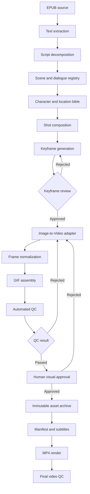

# Производственный pipeline «История одного камня»

Статус: **целевой производственный процесс, принят как архитектурная спецификация**.  
Проект движка: Cartoon-Engine.  
Конкретные генераторы изображений и Image-to-Video пока являются сменными адаптерами и не считаются выбранными или интегрированными.

## 1. Главный принцип

Производство разделено на две независимые фазы:

1. **Pre-production:** источник → сценарная декомпозиция → реплики → персонажи и локации → постановка → ключевой кадр → ручное утверждение.
2. **Production:** утверждённый ключевой кадр → Image-to-Video → нормализация кадров → GIF → автоматический QC → визуальная приёмка → архив.

Анимация запрещена до утверждения ключевого кадра. Финальный GIF запрещён до прохождения QC. Следующая сцена не запускается, пока текущая не получила статус `APPROVED`, если не включён явно разрешённый режим параллельной подготовки независимых сцен. Для первого фильма используется строго последовательный режим.

## 2. Граф конвейера



Автоматическая проверка не заменяет человеческую оценку смысла, композиции и идентичности персонажа. QC состоит из машинных проверок и отдельного визуального review.

## 3. Этапы и артефакты

| № | Этап | Вход | Результат |
|---|---|---|---|
| 01 | Импорт EPUB | EPUB | Извлечённый текст, структура разделов, контрольная сумма источника |
| 02 | Декомпозиция | Текст EPUB | Список сцен в исходном порядке |
| 03 | Разделение реплик | Текст сцены | Реплики до 10 слов без потери текста |
| 04 | Библия персонажей | Паспорт и утверждённые референсы | Канонические character records |
| 05 | Библия локаций | Паспорт и описания сцен | Канонические location records |
| 06 | Постановка | Сцена, персонажи, локация | Shot plan, камера, blocking, safe areas |
| 07 | Генерация keyframe | Shot plan и эталоны | Версионированный исходный кадр |
| 08 | Keyframe review | Исходный кадр | APPROVED или REJECTED с причиной |
| 09 | Анимация | Только approved keyframe | Image-to-Video результат |
| 10 | Сборка GIF | Нормализованные кадры | Отдельный GIF-эпизод |
| 11 | QC | GIF, scene spec, эталоны | Машинный отчёт и визуальная приёмка |
| 12 | Учёт | Принятые ресурсы | Manifest, subtitles.csv, архив |
| 13 | Монтаж | Только approved GIF и аудио | MP4 1920×1080 и отчёт финального QC |

Каждый этап сохраняет входы, выходы, параметры, prompt, версию адаптера, временные метки и причину отказа. Повторная попытка создаёт новую версию; предыдущие материалы не перезаписываются.

## 4. Персонажи

Идентификаторы стабильны и не зависят от имени файла:

### CHAR_GIRL_01
Главная героиня, ученица второго класса: стройная, светлые волосы, аккуратный пучок на макушке, детские черты, выразительные глаза. Лицо, пропорции, причёска и утверждённая одежда фиксируются эталонами.

### CHAR_MOTHER_01
Мама, около 45 лет: пышная фигура, брюнетка, доброжелательное выражение, постоянные лицо, причёска и одежда.

### CHAR_TEACHER_01
Учительница, около 55 лет: блондинка, короткая стрижка, очки, энергичный и доброжелательный образ, постоянные лицо и одежда.

**Разрешение расхождения источников:** для текущей производственной версии применяется последнее прямое указание владельца проекта: девочка стройная. Более раннее описание «полненькая» не использовать. Визуальный референс и утверждённый character record являются контрольными источниками для последующих сцен.

Персонажный референс передаётся генератору отдельно от предыдущего кадра. Кадр из другой локации не используется как композиционная основа новой сцены. Для сохранения идентичности разрешено передавать только утверждённые character reference assets и явно перечисленные prop references.

## 5. Локации

| ID | Локация |
|---|---|
| LOC_CLASSROOM | Школьный класс |
| LOC_HOME_HALLWAY | Домашняя прихожая |
| LOC_HOME_LIVINGROOM | Гостиная |
| LOC_EARTH_PRIMEVAL | Древняя Земля |
| LOC_EARTH_CROSS_SECTION | Разрез Земли |
| LOC_QUARRY | Гранитный карьер |
| LOC_SPB_EMBANKMENT | Набережная Санкт-Петербурга |

Локация — самостоятельный эталон с версией, композицией, палитрой, освещением и допустимыми объектами. При смене локации предыдущая сцена не передаётся как image reference; передаются только нужные character/prop references.

## 6. Структура production-проекта

```text
HISTORY_OF_GRANITE/
├── SOURCE/
│   ├── book.epub
│   └── project_passport.md
├── SCRIPT/
│   ├── scenes.yaml
│   └── subtitles.csv
├── CHARACTERS/
│   ├── girl/
│   ├── mother/
│   └── teacher/
├── LOCATIONS/
│   ├── classroom/
│   ├── home/
│   ├── earth/
│   ├── quarry/
│   └── city/
├── PRODUCTION/
│   ├── 00_INTRO/
│   ├── 01_CHAPTER/
│   ├── 02_CHAPTER/
│   └── ...
├── OUTPUT/
│   ├── GIF/
│   ├── MP4/
│   └── subtitles.csv
└── QC/
    ├── reports/
    └── rejected/
```

Внутри каталога каждой сцены хранить отдельные версии:
`scene.yaml`, `prompts/`, `keyframes/`, `animation/`, `frames/`, `gif/`, `qc/`, `archive/`.
Каталоги rejected не очищаются автоматически. Большие бинарные ресурсы не обязаны храниться в Git; в Git хранятся паспорта, метаданные, manifest, схемы и код.

## 7. Паспорт сцены

Минимальный пример:

```yaml
schema_version: 1
id: "01_01"
chapter: "Задание с камешком"
source:
  book_asset_id: "SOURCE_BOOK"
  section: "1"
scene:
  action: "Девочка приходит домой"
  location_id: "LOC_HOME_HALLWAY"
  character_ids:
    - "CHAR_GIRL_01"
camera:
  shot: "medium_wide"
  angle: "eye_level"
  movement: "static"
animation:
  duration_sec: 4.5
  fps: 12
  loop: true
subtitles:
  id: "01_01"
  speaker: "Девочка"
  text: "После уроков я прибежала домой"
  words: 5
quality:
  keyframe_status: "PENDING"
  animation_status: "BLOCKED"
  gif_status: "BLOCKED"
```

Число слов вычисляется программно. Значение `words` в YAML — кэшируемое поле, оно проверяется против текста, а не считается доверенным.

## 8. Состояния и переходы

Состояния сцены:

```text
PLANNED
  -> KEYFRAME_GENERATION
  -> KEYFRAME_REVIEW
      -> KEYFRAME_GENERATION (REJECTED, новая версия)
      -> KEYFRAME_APPROVED
  -> ANIMATION
  -> GIF_ASSEMBLY
  -> AUTOMATED_QC
      -> ANIMATION (REJECTED, новая версия)
      -> HUMAN_REVIEW (QC passed)
  -> HUMAN_REVIEW
      -> ANIMATION (визуальный брак, новая версия)
      -> APPROVED
  -> ARCHIVED
```

Статусы приёмки GIF строго два: `REJECTED` и `APPROVED`. Промежуточные состояния отражают незавершённые стадии и не являются статусом приёмки.

Каждый переход фиксирует actor, timestamp, asset version, result и reason. Запрещено утверждать GIF, если keyframe не approved, автоматический QC не passed или отсутствует визуальная приёмка.

## 9. QC

### Автоматические проверки
- GIF декодируется, содержит более одного кадра и не является статичным изображением.
- Длительность находится в диапазоне 3–5 секунд.
- Размер кадра соответствует производственному профилю 16:9.
- Нет пустых кадров, повреждённых кадров и неожиданных резких переходов.
- Изменение композиции между кадрами не превышает настроенные пороги.
- Нижняя пятая часть кадра свободна от лиц и важных объектов — автоматический детектор может только сформировать предупреждение; финальное решение визуальное.
- В GIF отсутствуют вшитые титры; субтитры существуют отдельно.
- Число слов в субтитре не превышает 10.
- CSV соответствует scene registry по ID, speaker, text, words и duration.
- Все ссылки на assets существуют и соответствуют утверждённым версиям.

### Визуальная приёмка человеком
- Соответствие EPUB и конкретному действию сцены.
- Правильные персонажи, лица, волосы, одежда и пропорции.
- Правильная локация и отсутствие переноса декораций из предыдущей сцены.
- Одно действие, один непрерывный кадр, один ракурс.
- Нет склеек, коллажей, посторонних событий.
- Low-poly 3D, матовая PLA-подобная фактура и согласованное освещение.
- Нижняя пятая часть свободна для будущей плашки.
- Субтитр действительно соответствует происходящему.

Машинный CV/VLM не объявляет семантическую проверку пройденной автоматически без подтверждения человека.

## 10. GIF и временная точность

Базовый профиль эпизода: 3–5 секунд, 12 FPS, 16:9, loop=true, один непрерывный план. Для 4,5 секунды при 12 FPS ожидается 54 кадра.

GIF хранит задержки кадров в сотых долях секунды. Поэтому фактическая длительность после кодирования измеряется и проверяется; нельзя считать, что произвольная дробная длительность точно представима. Для монтажного master рекомендуется сохранять также исходную последовательность кадров или промежуточный MP4, а GIF использовать как требуемый самостоятельный эпизод.

## 11. subtitles.csv и manifest

Канонический CSV хранится в `SCRIPT/subtitles.csv`. Копия для доставки создаётся в `OUTPUT/subtitles.csv`. Разделитель — точка с запятой, кодировка UTF-8.

Колонки в фиксированном порядке:

`id;file;chapter;speaker;text;words;duration_sec`

Для каждой принятой сцены manifest содержит:
- scene_id и chapter;
- source section и source text span;
- character/location IDs и версии эталонов;
- keyframe asset ID и checksum;
- animation asset ID и checksum;
- GIF path, checksum, frame count, dimensions, duration;
- prompt, adapter name/version и параметры генерации;
- QC report и approval record;
- subtitle row ID.

SQLite — индекс и журнал состояния. Файлы и manifest остаются переносимыми и читаемыми без базы данных.

## 12. Предлагаемый технологический стек

| Задача | Кандидат |
|---|---|
| Оркестрация и CLI | Python |
| Сценарии и паспорта | YAML |
| EPUB | EbookLib + BeautifulSoup |
| Валидация | Pydantic + JSON Schema или эквивалент |
| Генерация keyframe | ImageGen adapter |
| Анимация | Отдельный Image-to-Video adapter |
| Обработка кадров | Pillow, OpenCV |
| GIF | Pillow |
| MP4 | FFmpeg |
| Субтитры | Python |
| Учёт и аудит | SQLite |

Это кандидаты, не уже установленные зависимости. Image-to-Video провайдер выбирается после теста на сохранение идентичности, управление движением, стабильность камеры, доступность API, стоимость/лимиты и условия использования. Адаптер должен иметь единый внутренний контракт, чтобы поставщика можно было заменить.

## 13. CLI-контракт

Целевые команды:

```bash
python pipeline.py import-book SOURCE/book.epub
python pipeline.py build-script
python pipeline.py validate-script
python pipeline.py generate-keyframe 01_01
python pipeline.py review-keyframe 01_01
python pipeline.py approve-keyframe 01_01
python pipeline.py animate 01_01
python pipeline.py assemble-gif 01_01
python pipeline.py qc 01_01
python pipeline.py approve-gif 01_01
python pipeline.py subtitles
python pipeline.py render
python pipeline.py status
```

CLI-команды являются целевым интерфейсом. Они не считаются реализованными до появления кода и тестов.

## 14. Приоритет реализации

1. Модель проекта, сцены, персонажей, локаций и asset manifest.
2. Импорт EPUB, сохранение исходных фрагментов, сценарная декомпозиция и валидатор субтитров.
3. Keyframe generation adapter и обязательный approval gate.
4. Image-to-Video adapter, нормализация кадров и GIF assembly.
5. Автоматический QC, визуальное утверждение, архив и SQLite audit trail.
6. FFmpeg MP4 assembly и финальный QC.

## 15. Критерии готовности вертикального среза

На одной тестовой сцене доказано:
- импорт EPUB не меняет исходный текст;
- сцена и субтитры валидируются;
- keyframe сохраняется с prompt и версией;
- без approve-keyframe анимация блокируется;
- анимация сохраняется отдельно от GIF;
- GIF формируется воспроизводимо;
- QC обнаруживает специально внесённые дефекты;
- REJECTED не попадает в архив и MP4;
- APPROVED сцена попадает в manifest и монтаж;
- повторная генерация не уничтожает старые версии;
- итоговый MP4 проходит проверку параметров и декодирования.
